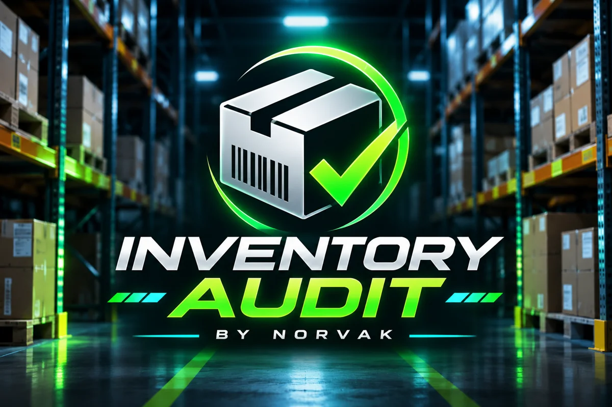

# Inventory Audit by Norvak

**Inventory Audit V2 · v2.0.0**

A focused, browser-local inventory auditing application by **Norvak Web**. Capture counts, identify shortages and overages, organize audit sessions, and export clear reports. Built from inventory control and quality assurance experience, with a straightforward interface for repetitive auditing.

**Deployment target:** [Inventory Audit V2](https://chepot87.github.io/Inventory-Audit-V2/). GitHub Pages will be enabled after owner approval; this link is not a claim that the application is already published.



## Features

- Dark, responsive Norvak dashboard with existing Norvak branding and approved artwork.
- Multiple barcodes per location, zero quantities, notes, creation timestamps and edit timestamps.
- Physical minus system discrepancy calculation, with labeled matching, shortage and overage states.
- Create, switch, rename, archive and reopen audit sessions.
- Edit records and confirm individual deletion or session history clearing.
- Automatically saved audit data and entry drafts. Keep the location after saving to speed up the next scan.
- Search location, barcode and notes; combine status and inclusive local date filters.
- Sort by timestamp, location, barcode, physical quantity, system quantity or difference. Display 25 results per page.
- CSV export and print reports include **every filtered result**, across all pages. Dashboard statistics always cover the entire active session.
- Full JSON backup and validated restore, with explicit replacement confirmation and a download of the previous data.
- Opt-in fictional demo inventory, stored in its own session.
- Keyboard navigation, visible focus, labeled inputs, live notifications, native modal dialogs and reduced-motion support.
- Browser storage conflict detection pauses writes when another tab changes the data.

## Usage

1. Choose an audit session, or use **New session** to create one for an area, shift or audit.
2. Enter a location. Scan or type a UPC / barcode, then physical and system quantities. Zero is valid. Every entry must be complete; blanks are never silently converted to zero.
3. Use **Add another UPC** to capture more items in that location. A batch can contain up to 40 barcodes. Saving is all-or-nothing if an entry is invalid.
4. Press **Save audit**. The location stays filled; focus returns to barcode entry.
5. Search, filter and sort audit records. Use row actions to edit or delete. Archive sessions when finished, then reopen them when changes are needed.
6. Export the current filtered results to CSV or print. Download a JSON backup regularly from **Data & backups**.

**Scanners:** Standard keyboard-emulating scanners work with the barcode text field. An Enter suffix advances to physical quantity. Enter continues through fields and saves after the last notes field; Tab follows normal browser navigation. No device-specific scanner integration is required. Physical hardware scanners have not been certified.

**Backups:** A JSON backup contains all V2 sessions, records and the current draft. Restoring replaces all V2 data after typing `RESTORE`. A copy of the previous data downloads first. Clearing session history requires typing `CLEAR`. Downloads still depend on browser permissions and available disk space; keep and verify your copies.

## Metrics

| Metric | Definition within the active session |
| --- | --- |
| Locations audited | Unique location identifiers, normalized to uppercase |
| Audit records | Number of saved counts |
| Matching records | Physical quantity equals system quantity |
| Discrepancies | Number of records where the quantities differ |
| Shortage units | Sum of `max(system − physical, 0)` |
| Overage units | Sum of `max(physical − system, 0)` |
| Match rate | Matching records ÷ all records × 100; no rate for an empty session |

Recounts are separate records, even when location and barcode repeat. These metrics describe audit records; they do **not** estimate warehouse stock, unique SKUs, financial loss, inventory value or overall inventory accuracy.

## Data, privacy and security

- Data stays in this browser profile under `norvak.inventory-audit.v2` in `localStorage`, using versioned, structured JSON. There is no backend, account, analytics or automatic synchronization across devices.
- The original ICQA Tool and its `inventoryLogTable` key are never read, changed or deleted. Legacy HTML storage is intentionally not imported.
- GitHub Pages projects under the same account share an origin. The unique key avoids accidental collisions, but localStorage is **not** encrypted or isolated from other scripts on that origin. It is unsuitable for sensitive employer information.
- User values are rendered with DOM text APIs, never interpreted as HTML. Quantities must be nonnegative whole numbers up to 1,000,000,000. Barcodes stay strings to preserve leading zeros.
- CSV fields escape quotes, commas and line breaks. Untrusted formula-leading text receives a protective apostrophe. Barcode fields also receive an apostrophe to help spreadsheets retain leading zeros. Some CSV consumers display this apostrophe literally. JSON retains exact values.
- Restore validates every session and record, rejecting invalid files as a whole. Files are limited to 8 MB; the application supports up to 500 sessions and 20,000 records, subject to browser storage capacity.
- A failed write produces a visible warning and does not report a record as saved. Conflicting changes from another tab pause writing. Back up unsaved work and reload to continue. This is a single-user tool; simultaneous collaborative editing is not supported.
- Browser data clearing, private mode, browser resets, profile changes and storage limits can remove or prevent persistence. Download backups. No public demo should contain employer inventory, employee data or internal operational information.

## Technologies and structure

Buildless HTML, CSS and JavaScript ES modules. No production dependencies, remote fonts, icon libraries, paid services or build step. The Manrope font is served locally with its OFL license. Existing Norvak assets are reused locally.

```text
Inventory-Audit-V2/
├── index.html          # Semantic interface and accessible form template
├── styles.css          # Dashboard, responsive and print styling
├── script.js           # DOM, sessions, persistence and user workflows
├── core.js             # Pure validation, metrics, filters and CSV logic
├── assets/             # Existing brand artwork, logo and licensed font
├── tests/core.test.js   # Node built-in regression tests
├── dev-server.mjs      # Loopback-only development preview
├── package.json
├── .nojekyll
└── README.md
```

## Local development

With Node.js installed, run from this folder:

```sh
npm start
npm test
```

On Windows systems where PowerShell blocks the `npm.ps1` launcher, use `npm.cmd start` and `npm.cmd test`, or `node dev-server.mjs` and `node --test`. Preview: `http://127.0.0.1:4173`. A local preview uses separate browser storage from the published GitHub Pages site. Export/import JSON if you want to transfer your own records between them.

## GitHub Pages

After approval, publish the `main` branch from the repository root using GitHub Pages' **Deploy from a branch** source. No secrets, build workflow or server are needed. All resource paths are relative and support the `/Inventory-Audit-V2/` project path. Verify the deployed application rather than relying solely on a successful commit.

## Current limitations

- Single browser profile; no team collaboration, cloud sync, authentication, encryption, offline service worker, inventory-system connection or role permissions.
- Whole unit counts only. Barcode values are flexible identifiers, without UPC check-digit validation.
- History clearing removes records from one session; sessions can be archived and renamed, but not deleted in this release.
- No automatic migration from the original ICQA Tool.
- Records use the device clock. Date filters use the device's local calendar date; CSV timestamps are ISO UTC.
- No automated discrepancy resolution, stock adjustment or compliance certification.
- CSV formula protection can change how a field displays in some spreadsheet programs. Use JSON for exact backups.

## Project identity

Inventory Audit by Norvak is independent software developed by [Norvak Web](https://chepot87.github.io/Norvak-Web-V3/). It is not affiliated with or endorsed by any retailer, warehouse operator or employer. The [original ICQA Tool](https://github.com/Chepot87/ICQAtool) remains a separate previous version.

Application code and Norvak brand artwork are not granted a third-party reuse license by this repository. The included Manrope font remains under its supplied OFL license.
